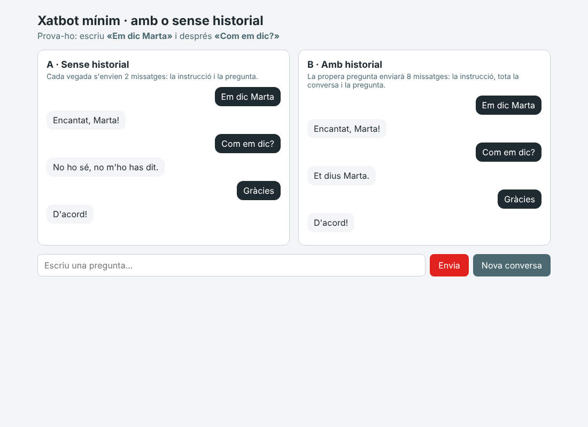

# Xatbot mínim · amb o sense historial

Exemple de **0488 Desenvolupament d'interfícies** (PratFP · DAM2, curs 2026-27).

El xatbot més senzill possible amb React i la IA gratuïta de **Groq**. Cada pregunta s'envia de **dues maneres** i es veuen
les dues respostes una al costat de l'altra:

| | Què s'envia a la IA | La IA recorda la conversa? |
|---|---|---|
| **A · Sense historial** | La instrucció + la pregunta d'ara (sempre 2 missatges) | ❌ No |
| **B · Amb historial** | La instrucció + **tota la conversa** + la pregunta d'ara (cada cop més missatges) | ✅ Sí |

Prova-ho: escriu **«Em dic Marta»** i després **«Com em dic?»**.



## Com engegar-lo

1. Aconsegueix una clau gratuïta a [console.groq.com/keys](https://console.groq.com/keys) (comença per `gsk_`).
2. Copia `.env.example` i anomena la còpia `.env`. Enganxa-hi la clau: `IA_CLAU=gsk_...`
3. Al terminal:

```bash
npm install
npm run dev
```

4. Obre l'adreça que surt (normalment http://localhost:5173).

> ⚠️ El fitxer `.env` **no es puja mai a GitHub** (és al `.gitignore`).

## On és el que importa

| Fitxer | Què hi ha |
|---|---|
| `src/ia.ts` | Les dues funcions: `preguntarSenseHistorial` (opció A) i `preguntarAmbHistorial` (opció B) |
| `src/App.tsx` | La pantalla: guarda les dues converses i envia la mateixa pregunta de les dues maneres |
| `vite.config.ts` | El proxy: el navegador demana `/api/ia` i Vite ho passa a Groq posant-hi la clau |

Obre la consola del navegador (F12): cada vegada que preguntes s'hi veu **quants missatges** s'envien a la IA.
